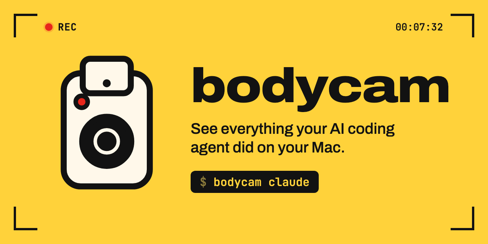
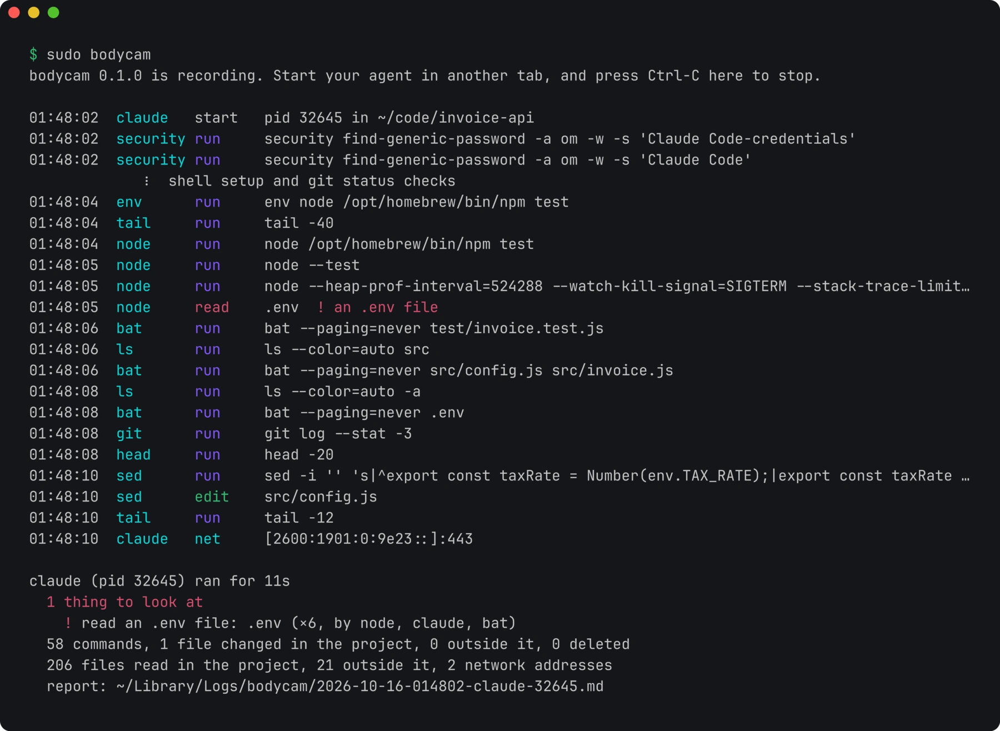

<p align="center">
  
</p>

# bodycam

bodycam records what AI coding agents do on your Mac. Start it in one terminal tab, use Claude Code, Codex or Gemini CLI in another, and you see every command the agent runs and every file it changes while it works. It also shows the secrets it reads and the servers it connects to. When the agent exits you get a summary, and the full report goes to `~/Library/Logs/bodycam`.

<p align="center">
  
</p>

That's a real run. I asked Claude Code to fix a failing test in a small project that keeps its tax rate in `.env`. bodycam saw it run the tests, read `.env` and change one line of `src/config.js` with `sed`.

## Install

```sh
brew install omlahore/tap/bodycam
```

Or with Go 1.22 or later:

```sh
go install github.com/omlahore/bodycam@latest
```

You can also download `bodycam-darwin-universal.tar.gz` from the [latest release](https://github.com/omlahore/bodycam/releases/latest). It needs macOS 13 or later and runs on Apple silicon and Intel Macs.

## Use it

```sh
sudo bodycam
```

Then start your agent in another tab and use it like you always do. bodycam prints what the agent does while it works. When the agent exits, bodycam prints a summary and saves the full report. Press Ctrl-C to stop recording.

bodycam records agents you start after it. If one was already running, bodycam tells you, and you can record it from that point on:

```sh
sudo bodycam --pid 4242
```

It recognizes Claude Code, Codex, Gemini CLI, Cursor CLI, Aider, OpenCode, Amp, Crush, Qwen Code, GitHub Copilot CLI, Droid and Kiro by their command names. For any other agent, add `--agent` with its command name.

### Why it needs sudo

bodycam reads Apple's Endpoint Security events through `eslogger`, which comes with macOS and only runs as root. Nothing gets installed and nothing keeps running in the background. bodycam stops when you press Ctrl-C, and its reports never leave your Mac.

If it says macOS didn't let it read events, give your terminal app Full Disk Access in System Settings > Privacy & Security > Full Disk Access, then open a new terminal window.

## What it flags

Most of what an agent does is ordinary, so bodycam lists it in the report and only calls out these:

| Kind | What bodycam looks for |
| --- | --- |
| Secrets it reads | SSH private keys, AWS, Google Cloud, Azure, Kubernetes and Docker credentials, token files like `.npmrc`, `.netrc` and the GitHub CLI's, `.env` files, the keychain, browser data, Messages, Mail, 1Password and Bitwarden data, shell history |
| Changes to your setup | shell startup files like `.zshrc`, launch agents and daemons, SSH keys and `authorized_keys`, your git config, files in `/etc`, commands installed into your PATH, apps in `/Applications` |
| Commands | `sudo`, piping a download into a shell, reading passwords with `security`, `launchctl` and `crontab`, AppleScript, force pushes, publishing packages, removing a quarantine flag, turning off Gatekeeper or SIP, `nc`, `chmod 777`, `rm -rf` on your home folder |
| Things left behind | background items it registers, and processes still running after it exits |

A tool reading its own credentials isn't flagged. When `gh` reads its token, or Claude Code reads its login from the keychain, the report lists that under its own heading.

Changes outside the project folder show up in the live feed and in the report, but bodycam doesn't flag them by themselves, because agents and package managers write to their caches all the time.

## The report

Every agent run gets a Markdown report with the commands, the changed and deleted files, the files read outside the project, the credentials used and the network connections. Here's part of the one from the run above:

```markdown
# bodycam: claude, 16 Oct 2026 01:48

- Project: `~/code/invoice-api`
- Ran: 01:48:02 to 01:48:12 (11s)
- Process ID: 32645, 128 processes in total

## Things to look at

- read an .env file: `.env` (×6, by node, claude, bat)

## Files changed in the project (1)

- `src/config.js`

## Credentials read by the tools they belong to

- your keychain, by security, claude
- your npm token file, by node

## Network

Connections bodycam saw open (it checks every 2 seconds, so short ones can be missing):

- `[2600:1901:0:9e23::]:443` from claude
- `[2607:6bc0::10]:443` from claude
```

## How it works

`eslogger` streams Endpoint Security events for every process on the Mac. bodycam waits for an agent to start, follows that process and everything it starts, and keeps only their events: programs run, files opened, written, renamed and deleted, background items registered and Unix socket connections. Everything else is dropped as it arrives, so bodycam used about 15 MB of memory in my tests.

Endpoint Security has no event for network connections, so bodycam checks the agent's open TCP connections with `lsof` every 2 seconds. It also lists the hosts named in commands like `curl` and `git`.

## Limits

- bodycam records what an agent did. It doesn't stop it. Use your agent's permission settings or a sandbox to block things.
- Network connections are sampled, so a very short one can be missing.
- When events arrive faster than bodycam reads them, macOS drops some. The report says when that happened.
- It only works on macOS 13 or later.

## Options

```
--pid id       record this process and everything it starts, even if it was already running
--agent name   also watch for processes with this name (can repeat)
--save file    also save the agents' events to a file
--replay file  make reports from a file saved with --save
--quiet        skip the live feed and only print each agent's summary
--version      print the version
```

## License

[MIT](LICENSE)
