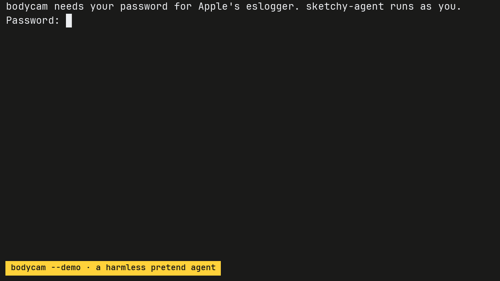

<p align="center">
  
</p>

# bodycam

bodycam records what AI coding agents do on your Mac. Run your agent through it, like `bodycam claude`, and you get every command the agent ran, every file it changed, the secrets it read and the servers it connected to. When the agent exits you get a summary, and the full report goes to `~/Library/Logs/bodycam`.

<p align="center">
  
</p>

That's a real recording. First a harmless pretend agent does a few risky-looking things and bodycam flags each one. Then Claude Code fixes a failing test in a small project that keeps its tax rate in `.env`, and bodycam shows it running the tests, reading `.env` and editing `src/config.js`.

<p align="center">
  <a href="https://omlahore.github.io/bodycam/">omlahore.github.io/bodycam</a>
</p>

## Install

```sh
brew install omlahore/tap/bodycam
```

Or with Go 1.22 or later:

```sh
go install github.com/omlahore/bodycam@latest
```

You can also download `bodycam-darwin-universal.tar.gz` from the [latest release](https://github.com/omlahore/bodycam/releases/latest). It needs macOS 13 or later and runs on Apple silicon and Intel Macs.

## Try it

```sh
bodycam --demo
```

This runs a pretend agent that reads a `.env` file, pipes a download into a shell that only parses it, tries `sudo` without a password and a few more things like that. Nothing gets changed or sent anywhere, and you see what bodycam flags.

## Use it

Put `bodycam` in front of the command that starts your agent:

```sh
bodycam claude
bodycam codex
bodycam gemini
```

bodycam asks for your Mac password once, then runs the agent as you, in the same terminal. When the agent exits, bodycam prints a summary and saves the full report. To watch what the agent does while it works, run this in another tab:

```sh
tail -f ~/Library/Logs/bodycam/live.log
```

It works with any command, not just agents. `bodycam npm install` shows you what a package's install scripts did.

If you start agents some other way, for example from an editor, run bodycam on its own with sudo. It then records every agent started anywhere on the Mac, and reports on each one when it exits:

```sh
sudo bodycam
```

In this mode it recognizes Claude Code, Codex, Gemini CLI, Cursor CLI, Aider, OpenCode, Amp, Crush, Qwen Code, GitHub Copilot CLI, Droid and Kiro by their command names. Add others with `--agent`, or record one that's already running with `--pid`.

### Why it needs your password

bodycam reads Apple's Endpoint Security events through `eslogger`, which comes with macOS and only runs as root. Only `eslogger` runs as root. Your agent runs as you. Nothing gets installed and nothing keeps running in the background. bodycam stops when your agent exits, and its reports never leave your Mac.

If it says macOS didn't let it read events, give your terminal app Full Disk Access in System Settings > Privacy & Security > Full Disk Access, then open a new terminal window.

## What it flags

Most of what an agent does is ordinary, so bodycam lists it in the report and only calls out these:

| Kind | What bodycam looks for |
| --- | --- |
| Secrets it reads | SSH private keys, AWS, Google Cloud, Azure, Kubernetes and Docker credentials, token files like `.npmrc`, `.netrc` and the GitHub CLI's, `.env` files, the keychain, browser data, Messages, Mail, 1Password and Bitwarden data, shell history |
| Changes to your setup | shell startup files like `.zshrc`, launch agents and daemons, SSH keys and `authorized_keys`, your git config, files in `/etc`, commands installed into your PATH, apps in `/Applications` |
| Commands | `sudo`, piping a download into a shell, reading passwords with `security`, `launchctl` and `crontab`, AppleScript, force pushes, publishing packages, removing a quarantine flag, turning off Gatekeeper or SIP, `nc`, `chmod 777`, `rm -rf` on your home folder |
| Things left behind | background items it registers, and processes still running after it exits |

A tool reading its own credentials isn't flagged. When `gh` reads its token, or Claude Code reads its login from the keychain, the report lists that under its own heading.

Changes outside the project folder show up in the live feed and in the report, but bodycam doesn't flag them by themselves, because agents and package managers write to their caches all the time.

## The report

Every agent run gets a Markdown report with the commands, the changed and deleted files, the files read outside the project, the credentials used and the network connections. Values that look like keys or tokens in command lines are masked, so you can share a report without leaking them. Here's part of one:

```markdown
# bodycam: claude, 16 Oct 2026 01:48

- Project: `~/code/invoice-api`
- Ran: 01:48:02 to 01:48:12 (11s)
- Process ID: 32645, 128 processes in total

## Things to look at

- read an .env file: `.env` (×6, by node, claude, bat)

## Files changed in the project (1)

- `src/config.js`

## Credentials read by the tools they belong to

- your keychain, by security, claude
- your npm token file, by node

## Network

Connections bodycam saw open (it checks every 2 seconds, so short ones can be missing):

- `[2600:1901:0:9e23::]:443` from claude
- `[2607:6bc0::10]:443` from claude
```

## How it works

`eslogger` streams Endpoint Security events for every process on the Mac. bodycam follows your agent and everything it starts, and keeps only their events: programs run, files opened, written, renamed and deleted, background items registered and Unix socket connections. Everything else is dropped as it arrives, so bodycam used about 15 MB of memory in my tests.

Endpoint Security has no event for network connections, so bodycam checks the agent's open TCP connections with `lsof` every 2 seconds. It also lists the hosts named in commands like `curl` and `git`.

## What it can't see

- A network connection that opens and closes between two checks.
- What's inside the agent's requests, like the prompts and code it sends to its API. bodycam sees which server the agent talked to, not what it said.
- Which keychain items the agent read through Apple's API. bodycam sees the keychain being opened and lists it without flagging it, and macOS asks you before one app can read another app's item.
- Events macOS drops when they arrive faster than bodycam can read them. The report says when that happened.
- Anything that happened before you started recording.

bodycam records what an agent did. It doesn't stop it. To block things, use your agent's permission settings or a sandbox.

## Not on a Mac?

[AgentSight](https://github.com/eunomia-bpf/agentsight) watches AI agents on Linux with eBPF, and [Aegis](https://github.com/antropos17/Aegis) does it on Windows.

## Options

```
bodycam <command>    run the command and record what it does
bodycam --demo       record a harmless pretend agent
sudo bodycam         record every agent started on this Mac

--pid id       with sudo bodycam, also record this already running process
--agent name   with sudo bodycam, also watch for processes with this name (can repeat)
--save file    also save the agent's events to a file
--replay file  make reports from a file saved with --save
--quiet        don't write the live feed, only the summary and report
--version      print the version
```

## License

[MIT](LICENSE)
